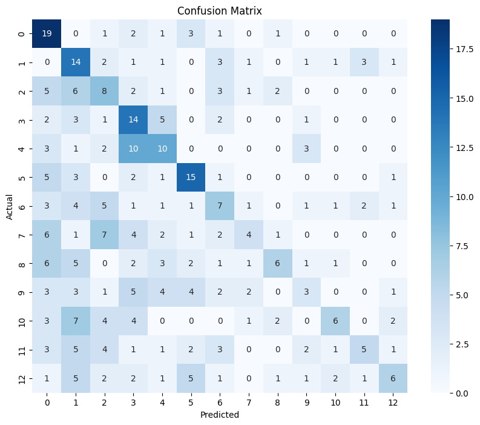

# Date Fruit Classification (SODA Challenge)

A machine learning project that classifies Saudi date varieties from images, built for the SODA Challenge (CCWin Challenges Series 1, College of Computing, Umm Al-Qura University) on Kaggle.

> Final project for the Machine Learning for Data Science course, Data Science Department, Umm Al-Qura University.

## Dataset
- Source: [SODA Challenge on Kaggle](https://www.kaggle.com/competitions/soda-challenge/overview). The data is not included in this repo.
- 1,829 training images, 13 balanced classes (about 140 images each), and 784 test images.
- CSV files with two columns: `id` (image filename) and `label` (class number).

## Method
| Step | Details |
|------|---------|
| Data checks | No missing values; all image files exist; no corrupted images found |
| EDA | Class distribution plot: the 13 classes are almost perfectly balanced, so no resampling was needed |
| Preprocessing (OpenCV) | Resized to 64×64, normalized pixel values (0 to 1), flattened into 12,288 features |
| Split | 80% training / 20% validation, stratified, `random_state=42` |
| Model | K-Nearest Neighbors (k = 3, Euclidean distance) |
| Submission | Predictions for the test images saved as `submission.csv` and submitted to Kaggle |

## Results
| Metric | Value |
|--------|-------|
| Validation accuracy | 31.97% |
| Random-guess baseline | 7.7% (1 of 13 classes) |
| Macro F1-score | 0.30 |
| Weighted F1-score | 0.30 |

- The model is about 4 times better than random guessing, but still weak.
- Some varieties are often confused with each other (for example classes 3 and 4, and classes 9 and 10).
- Class 1 had the highest recall (0.68) and class 10 was the hardest.
- KNN on raw pixels is limited for visually similar varieties.

## Future Work
Use a CNN or transfer learning (pretrained image models) instead of raw-pixel KNN.

## Files
- `soda_challenge_knn.ipynb`: full notebook (written for Kaggle)

## How to Run
1. Open the notebook on Kaggle and attach the SODA Challenge dataset.
2. Run all cells. Paths in the notebook point to `/kaggle/input/competitions/soda-challenge/...`.

## Future Work
- Use a CNN or transfer learning with a pretrained image model, instead of raw-pixel KNN
- Add data augmentation (flips, rotations, brightness changes)
- Try richer features (color histograms, HOG) and tune `k` and the distance metric
- Use cross-validation for more reliable evaluation

  
## Tools Used
Python, pandas, NumPy, scikit-learn, OpenCV, seaborn, Matplotlib, Kaggle

## Team
- Fay Salman Alzahrany
- Linda Almajnooni
